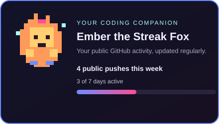
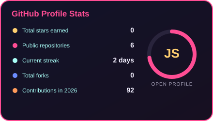

  

---

## 🔥 GitHub Stats, Commits & Streak
<i>⚡ Click any card to explore all repositories!</i>

<table align="center" width="900">
  <tr>
    <td align="center" width="50%">
      
    </td>
    <td align="center" width="50%">
      
    </td>
  </tr>
</table>

<table align="center" width="900">
  <tr>
    <td align="center" width="50%">
      
    </td>
    <td align="center" width="50%">
      
    </td>
  </tr>
</table>
<i>📊 The buddy tracks public push activity from the last 7 days. Git stats refresh every 30 minutes; the contribution streak and yearly total use the GitHub contribution calendar.</i>

  

<i>🌐 Language usage is calculated from repository code size and refreshed every 30 minutes by GitHub Actions.</i>

## 🐍 Contribution Snake Eater
<i>🎮 Interactive contribution grid animation (updates every 30 minutes). Click grid to view all repositories!</i>

  

